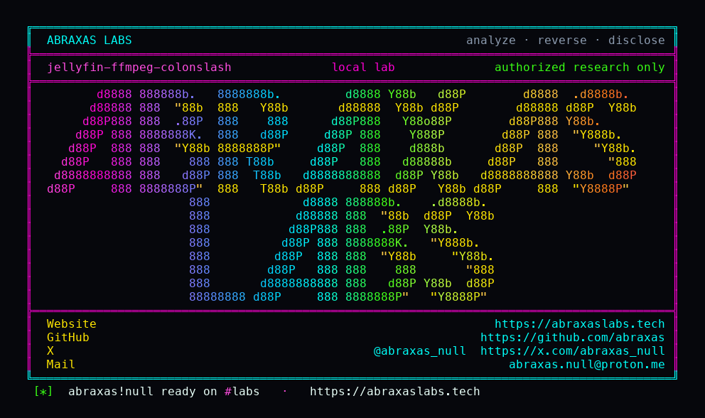

<p align="center">
  
</p>

<p align="center">
  <a href="https://abraxaslabs.tech"><strong>abraxaslabs.tech</strong></a>
  &nbsp;·&nbsp;
  <a href="https://github.com/abraxas">github.com/abraxas</a>
  &nbsp;·&nbsp;
  <a href="https://x.com/abraxas_null">@abraxas_null</a>
  &nbsp;·&nbsp;
  <a href="mailto:abraxas.null@proton.me">abraxas.null@proton.me</a>
  &nbsp;·&nbsp;
  <a href="https://github.com/abraxas/jellyfin-ffmpeg-colonslash">jellyfin-ffmpeg-colonslash</a>
</p>

# jellyfin-ffmpeg-colonslash

**Class:** FFmpeg argument injection
**Reach:** Remote after a library `.strm` plant (writer of a scanned media folder, then unauth stream)

**Jellyfin Server** `v12.2` (`ca0f16eb7c195f720a1493ed469a27c4657db0c6`) - Jellyfin. Image `jellyfin/jellyfin:12.2`.

[GHSA-wwwm-px48-fpvq](https://github.com/jellyfin/jellyfin/security/advisories/GHSA-wwwm-px48-fpvq) / [PR 17685](https://github.com/jellyfin/jellyfin/pull/17685) added `EscapeProcessArgument` on conversion argv and the `file:` `-i` branch. Non-File protocol still wraps the raw path in quotes without that escape ([`EncodingUtils.cs:14-71`](https://github.com/jellyfin/jellyfin/blob/v12.2/MediaBrowser.MediaEncoding/Encoder/EncodingUtils.cs)). `ManagedFileSystem.IsPathFile` is false for `://` that is not `file://`. `TranscodeManager` still builds `ProcessStartInfo.Arguments` as one string.

A scanned library `.strm` whose first line is an `http` URL containing `"` is classified Http. `Uri.TryCreate` accepts that URL. Unauth `GET /Videos/{id}/stream` (no `static`) starts ffmpeg. The lab log is:

```
-i "http://127.0.0.1/a" JELLYFIN-FFMPEG-COLONSLASH-WITNESS "x"
```

Control `LabControl.mkv` stays one argument: `-i file:"/media/movies/LabControl.mkv"`.

**A POSIX filename with `://` does not hit this sink.** Slash cannot be a filename. The lab plant `a://b"…"x.mkv` is stored as `/media/movies/a:/b"…"x.mkv` and takes the escaped File branch. Do not file a filename-with-colonslash variant. I am not claiming plugin-DLL RCE. The lab proves the argv split only.

Leftover **#4** of the [Jellyfin 12.2 leftovers](https://abraxaslabs.tech/research/jellyfin-12.2-leftovers) series.

| | |
|---|---|
| ID | no CVE yet |
| Class | **FFmpeg argument injection** (CWE-88) |
| Reach | **Remote** after a library `.strm` plant, then unauth stream |
| CWE | [CWE-88](https://cwe.mitre.org/data/definitions/88.html) |
| CVSS | **High: 7.1** `CVSS:3.1/AV:N/AC:L/PR:L/UI:N/S:U/C:L/I:H/A:N` |
| Product | [Jellyfin Server](https://github.com/jellyfin/jellyfin) |
| Affected | **v12.2** (`ca0f16eb`) image `jellyfin/jellyfin:12.2` |
| Auth | library writer for the plant; stream is unauthenticated |
| License | [GNU Affero GPL v3.0](LICENSE) |
| Lab | `127.0.0.1` only |

## What an attacker can do

Same plant model as GHSA-wwwm: write a `.strm` into a scanned media folder (NAS / Samba / guest share). Then anyone who can open TCP to the server can `GET /Videos/{id}/stream` with no `Authorization` and no `static`. That is the full privilege set. Nothing in this list is a shell or plugin-DLL RCE.

| Axis | Method + path | Grants | Provenance |
|---|---|---|---|
| Integrity / argv | unauth `GET /Videos/{id}/stream` after a library `.strm` plant | Extra ffmpeg arguments outside the `-i` quotes | **Lab-proven.** TranscodeManager log |
| Recon | same plus `-vf drawtext=textfile=` | Host file bytes in the transcode | Inferred gadget; not run |
| Integrity | `-attach` / `-dump_attachment` | jellyfin-UID write | Inferred; plugin load not shown |
| RCE | not claimed | - | - |

### What this leftover does not grant

- No shell. No `ProcessBuilder`. No plugin-DLL RCE. The old [GHSA-866x](https://github.com/jellyfin/jellyfin/security/advisories/GHSA-866x-wj5j-2vf4) chain is historical and is **not** shown here.
- Quote-only File paths stay escaped on the File branch.
- A POSIX filename with `://` becomes a directory (`a:`) plus a file. Canonical Path has no `://`, so it hits the escaped `file:` `-i` branch.
- [GHSA-jh22](https://github.com/jellyfin/jellyfin/security/advisories/GHSA-jh22-fw8w-2v9x) `level` TryParse is closed.
- Codec query strings still match the regex.
- `.strm` local / `file://` paths are dropped (`ProbeProvider` keeps `http` / `https` / `rtsp` / `rtp` only).
- `EncoderAppPath` cannot be set via the encoding config API.
- Subtitle-upload `.strm` (GHSA-j2hf) stays closed.

## How I found it

I pinned [jellyfin/jellyfin](https://github.com/jellyfin/jellyfin) **v12.2**. Twenty source hunts, then four independent loopback labs. PR 17685 escaped conversion argv and `file:` `-i`. The Http / rtsp wrappers were left as `"%s"`. The first plant I tried was a POSIX filename containing `://`. That plant is a directory. The leftover that fires is a `.strm` whose URL already contains `://` and `"`.

Wrong turn, in that order: treating `GetFileInputArgument`'s `path.Contains("://")` shortcut as a filename bug. Slash is a separator. The File branch already escapes. The non-File branch does not.

Siblings on this pin: [jellyfin-suggestions-idor](https://github.com/abraxas/jellyfin-suggestions-idor), [jellyfin-svg-gzip](https://github.com/abraxas/jellyfin-svg-gzip), [jellyfin-playlist-itemids](https://github.com/abraxas/jellyfin-playlist-itemids).

## Lab

Loopback client: [`jellyfin-ffmpeg-colonslash-Abraxas-Labs.py`](jellyfin-ffmpeg-colonslash-Abraxas-Labs.py). Stack: [`lab/`](lab/) ([docker-compose.yml](lab/docker-compose.yml), [poc.py](lab/poc.py), [run.sh](lab/run.sh)). Authorized lab only. It talks to loopback.

```bash
python3 jellyfin-ffmpeg-colonslash-Abraxas-Labs.py
```

Or:

```bash
cd lab
./run.sh
```

Target **only** `http://127.0.0.1:18810`. Image `jellyfin/jellyfin:12.2`. Compose project `jellyfin-ffmpeg-colonslash`. Witness `JELLYFIN-FFMPEG-COLONSLASH-WITNESS`.

`poc.py` writes `LabControl.mkv` (control, one `-i file:"..."`) and `LabPlant.strm` whose URL is `http://127.0.0.1/a" JELLYFIN-FFMPEG-COLONSLASH-WITNESS "x`. Unauth `GET /Videos/{id}/stream` (no `static`) logs the quote-break. Last line:

```
SUCCESS jellyfin-ffmpeg-colonslash argv-split=yes plant-i=quote-break control-id=f603a52f649bcf822b333c4d5f21cc86 plant-id=d7aabf0935bb524e1667b1ff9bb945d9 JELLYFIN-FFMPEG-COLONSLASH-WITNESS
```

## Fix

Call `EscapeProcessArgument` on every `GetInputArgument` branch, including Http and rtsp. Keep wrapping, but quote-escape the inner string the way the `file:` branch already does.

## Source

- [`MediaBrowser.MediaEncoding/Encoder/EncodingUtils.cs:14-71`](https://github.com/jellyfin/jellyfin/blob/v12.2/MediaBrowser.MediaEncoding/Encoder/EncodingUtils.cs)
- [`Emby.Server.Implementations/IO/ManagedFileSystem.cs:533-541`](https://github.com/jellyfin/jellyfin/blob/v12.2/Emby.Server.Implementations/IO/ManagedFileSystem.cs)
- [`MediaBrowser.MediaEncoding/Transcoding/TranscodeManager.cs:417-431`](https://github.com/jellyfin/jellyfin/blob/v12.2/MediaBrowser.MediaEncoding/Transcoding/TranscodeManager.cs)
- [`Jellyfin.Api/Controllers/VideosController.cs:314-318, 483-486`](https://github.com/jellyfin/jellyfin/blob/v12.2/Jellyfin.Api/Controllers/VideosController.cs)
- Closed sibling: [GHSA-wwwm-px48-fpvq](https://github.com/jellyfin/jellyfin/security/advisories/GHSA-wwwm-px48-fpvq) / [PR 17685](https://github.com/jellyfin/jellyfin/pull/17685)

## Contact

Abraxas Labs - [abraxaslabs.tech](https://abraxaslabs.tech) - [github.com/abraxas](https://github.com/abraxas) - [@abraxas_null](https://x.com/abraxas_null) - [abraxas.null@proton.me](mailto:abraxas.null@proton.me)

## License

GNU Affero GPL v3.0. See [LICENSE](LICENSE). Loopback lab only. No warranty.
